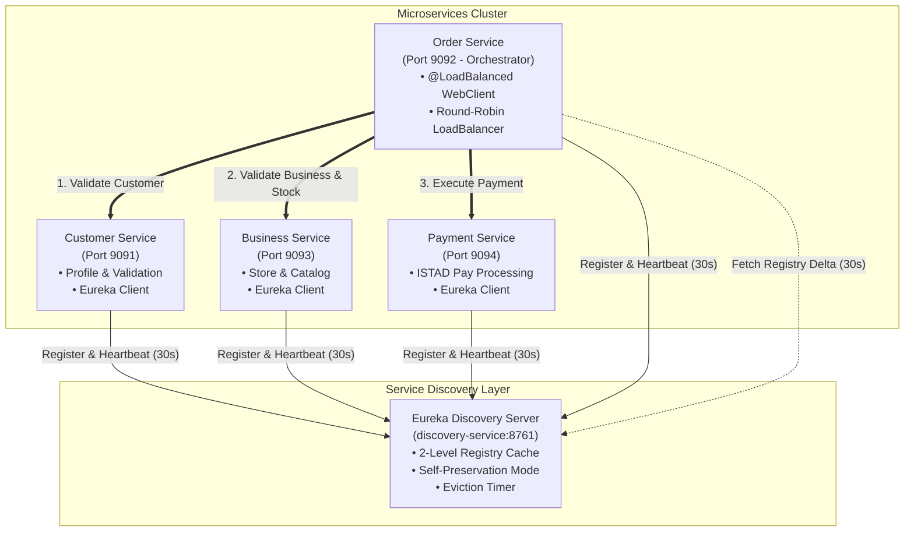
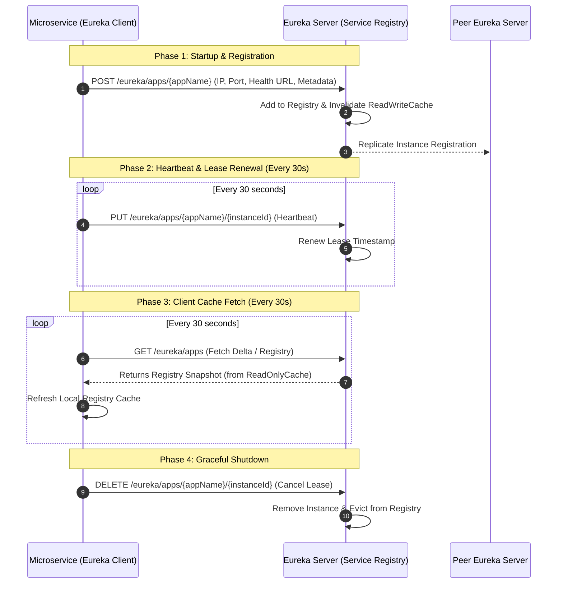
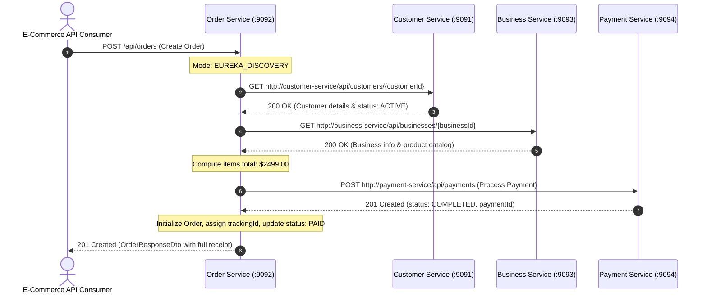

# ✍️ ASSIGNMENT & RESEARCH REPORT
## IMPLEMENTING SPRING CLOUD EUREKA & LOAD BALANCING IN MICROSERVICES ARCHITECTURE

**Project:** ISTAD ITE E-Commerce Platform (`istad-ite-project`)  
**Author:** Leng Saroth (`it-roth`)  
**Technology Stack:** Java 25 LTS, Spring Boot 4.1.2, Spring Cloud Netflix Eureka 5.0.3, Spring Cloud LoadBalancer 5.0.4, Spring WebFlux, Reactive MongoDB, Gradle 9.7.0  
**Repository:** [istad-ite-project](https://github.com/it-roth/istad-ite-platform)  
**Submission Format:** Google Docs & GitHub Link  

---

## 🧭 EXECUTIVE SUMMARY & SYSTEM TOPOLOGY

This research and implementation assignment provides an end-to-end evaluation and integration of **Spring Cloud Eureka (Netflix OSS)** and **Spring Cloud LoadBalancer** for dynamic service discovery and client-side load balancing. It systematically replaces brittle, hard-coded service addresses with a resilient, decentralized service discovery registry across four enterprise e-commerce microservices:

1. **Discovery Service (Eureka Server)**: `http://localhost:8761`
2. **Customer Service**: `http://localhost:9091` (`customer-service`)
3. **Order Service (Orchestrator)**: `http://localhost:9092` (`order-service`)
4. **Business Service**: `http://localhost:9093` (`business-service`)
5. **Payment Service**: `http://localhost:9094` (`payment-service`)

### System Architecture Diagram



---

## 🎯 PART 1: HARD-CODED SERVICE COMMUNICATION (+20 pts)

### 1.1 Implementation Architecture
In the hard-coded service communication model, each microservice communicates with collaborator services using static IP addresses and port numbers hardcoded in property files or Java source code:

* **Customer Service:** `http://localhost:9091/api/customers/{id}`
* **Business Service:** `http://localhost:9093/api/businesses/{id}`
* **Payment Service:** `http://localhost:9094/api/payments`

The `OrderOrchestratorService` utilizes a direct `WebClient` bean configured with static URLs:
```java
// Hard-coded direct WebClient configuration
@Bean
public WebClient directWebClient() {
    return WebClient.builder().build();
}
```

### 1.2 Verification and API Test Execution
To test the hard-coded communication pathway, execute the dedicated test endpoint:

```bash
curl -X GET http://localhost:9092/api/orders/communication-test/hard-coded
```

#### Expected JSON Output:
```json
{
  "testMode": "HARD_CODED_SERVICE_ADDRESSES",
  "allServicesReachable": true,
  "totalDurationMs": 142,
  "results": {
    "customerService": {
      "serviceName": "customer-service",
      "targetUrl": "http://localhost:9091/api/customers",
      "success": true,
      "statusCode": 200,
      "latencyMs": 48,
      "note": "Customer microservice health & endpoints"
    },
    "businessService": {
      "serviceName": "business-service",
      "targetUrl": "http://localhost:9093/api/businesses",
      "success": true,
      "statusCode": 200,
      "latencyMs": 44,
      "note": "Business microservice catalog & products"
    },
    "paymentService": {
      "serviceName": "payment-service",
      "targetUrl": "http://localhost:9094/api/payments",
      "success": true,
      "statusCode": 200,
      "latencyMs": 35,
      "note": "Payment microservice transaction processor"
    }
  },
  "summary": "Direct REST communication executed against static, hard-coded IP:Port configurations."
}
```

> **Screenshot Placeholder 1:** *[Insert screenshot of Postman / Terminal running `GET http://localhost:9092/api/orders/communication-test/hard-coded` displaying HTTP 200 and the JSON response above]*

---

### 1.3 Detailed Report: Problems, Limitations, and Disadvantages of Hard-Coded Addresses

1. **Tight Coupling and Deployment Rigidity:**
   Services are tightly bound to network infrastructure details (hostnames, static IPs, and ports). If the `Customer Service` moves to another machine, host port, or availability zone, all dependent microservices (`Order Service`) must have their configurations updated and redeployed.

2. **Zero Elasticity and Inability to Auto-Scale:**
   In cloud-native systems, traffic spikes require spinning up multiple instances of a service. With hard-coded URLs, client services can only send requests to the single designated `http://localhost:9091`. The newly spawned instances remain completely unutilized.

3. **Single Point of Failure (SPOF) and Lack of Failover:**
   If the instance running at `http://localhost:9091` crashes, restarts, or undergoes maintenance, all upstream calls fail immediately with `Connection refused` (HTTP 503/500). There is no automated fallback or rerouting to healthy sibling nodes.

4. **Incompatibility with Modern Containerized Environments (Docker & Kubernetes):**
   In cloud platforms, container orchestration engines allocate **dynamic, ephemeral IP addresses** whenever containers are rescheduled, restarted, or scaled. Static IP configurations break instantly upon container restart.

5. **Port Allocation Collisions and Configuration Drift:**
   On shared hosts or developer environments, multiple services frequently clash over ports (e.g., port 8080 or 9091). Managing dozens of distinct port numbers across staging, testing, and production environments leads to human error and severe configuration drift.

6. **Absence of Intelligent Client-Side Load Balancing:**
   Hard-coded URLs do not support round-robin, least-connections, or weighted response distribution without an expensive intermediary hardware/software proxy.

---

## 🔬 PART 2: RESEARCH SPRING CLOUD EUREKA (+20 pts)

### 2.1 Origin and Purpose
* **Origin:** Netflix originally engineered **Eureka** around 2011–2012 as part of the **Netflix Open Source Software (Netflix OSS)** suite. Netflix was migrating its massive video streaming infrastructure from physical datacenters to Amazon Web Services (AWS EC2).
* **Core Problem Solved:** AWS EC2 virtual machines were dynamic and ephemeral; server IPs changed frequently due to reboots, autoscaling, and hardware degradations. Traditional DNS took too long to propagate (due to TTL caching), and hardware load balancers became single bottlenecks. Netflix designed Eureka to provide a resilient, distributed, client-side service registry and lookup mechanism specifically built to tolerate AWS cloud anomalies.
* **Spring Cloud Integration:** Pivotal (now VMware / Broadcom) wrapped Netflix Eureka into the **Spring Cloud Netflix** project, providing native auto-configuration via `@EnableEurekaServer` and `@EnableDiscoveryClient`.

---

### 2.2 Eureka Architectural Components & Lifecycle



1. **Eureka Server (Registry Host):**
   * Acts as a phonebook for all microservices. Maintains an in-memory registry of service names (`VIP - Virtual IP`) and their running instances (IP addresses, ports, health status, and metadata).
   * Runs peer-to-peer clustering without master-slave hierarchy. Every node replicates state to all peers.

2. **Eureka Client (Service Instances):**
   * Embedded inside each microservice via `spring-cloud-starter-netflix-eureka-client`.
   * Automatically registers the application upon startup (`POST /eureka/apps/{appName}`).
   * Sends periodic heartbeats (default every 30 seconds) to maintain its lease (`PUT /eureka/apps/{appName}/{instanceId}`).
   * Periodically fetches and caches the entire registry locally (default every 30 seconds), enabling client-side load balancing even if the Eureka Server is temporarily offline.

3. **Service Registration & Discovery:**
   * **Registration:** When `customer-service` boots on port 9091, it transmits an `InstanceInfo` packet containing its IP address, port, health check URL, and status (`UP`).
   * **Discovery:** When `order-service` needs to contact `customer-service`, it does not query DNS or Eureka Server synchronously on every HTTP call. Instead, it queries its **local in-memory Eureka registry cache** for `CUSTOMER-SERVICE`, selects an active instance via round-robin load balancing, and opens a direct socket connection.

---

### 2.3 Deep-Dive: Eureka Internals, Caching, and Resilience

#### A. Eureka 2-Tier Server Cache Architecture
To handle thousands of client queries per second without locking the core registry, Eureka Server utilizes a two-level cache:
1. **Read-Write Cache (`readWriteCacheMap`):** A Guava/Caffeine cache with write-through mechanics that directly reflects registrations, cancellations, and renewals.
2. **Read-Only Cache (`readOnlyCacheMap`):** An in-memory cache used to serve client `GET /eureka/apps` discovery requests. An internal timer (default: `eureka.server.response-cache-update-interval-ms = 30000`) asynchronously flushes changes from the read-write cache into the read-only cache.
* **Architectural Trade-off:** This design guarantees sub-millisecond registry queries, but introduces an **eventual consistency lag of up to 30–60 seconds** before a newly registered or deceased instance is visible to all consumers.

#### B. Self-Preservation Mode (`enable-self-preservation`)
* If network congestion or a partition occurs between the Eureka Server and a group of microservices, the server might stop receiving heartbeats even though the microservices are healthy and communicating with each other.
* If Eureka were to delete every non-renewing instance, it would purge the entire registry during a minor network glitch.
* **Mechanism:** Eureka calculates an expected renewal threshold:
  $$\text{Expected Renewals per Min} = 2 \times \text{Registered Instances} \times \text{renewal-percent-threshold (0.85)}$$
  If actual renewals drop below 85% in a 15-minute window, Eureka Server enters **Self-Preservation Mode**. It halts the eviction of expired instances, displays a prominent red warning banner in the dashboard, and protects the active registry until heartbeats normalize.

#### C. CAP Theorem Analysis: AP over CP
Under Eric Brewer's CAP Theorem, Eureka explicitly chooses **Availability (A) and Partition Tolerance (P)** over **Consistency (C)**:
* Unlike ZooKeeper, etcd, or Consul (which use Raft/Paxos consensus and reject reads/writes if quorum is lost), Eureka nodes operate independently in a peer-to-peer gossip topology.
* Even if Eureka Server nodes cannot talk to each other, each node continues accepting registrations and serving queries from its stale local cache. In microservices, routing traffic to a slightly stale instance with client-side retry is far superior to system-wide downtime caused by consensus failure.

#### D. Drawbacks of Eureka
* **Stale Registries:** Eviction delays and multi-tier cache intervals mean clients can receive dead instance addresses for up to 90–120 seconds unless circuit breakers (Resilience4j) are paired with it.
* **Java/JVM Centric:** Best supported within the Spring/Java ecosystem; non-Java services require sidecars (Eureka sidecar or Prana).
* **Maintenance Mode:** Netflix placed Eureka 2.x on indefinite hold, though Spring Cloud Netflix Eureka 1.x / 5.x remains robust and actively maintained by the community.

---

## 🚀 PART 3: INTEGRATE EUREKA & LOAD BALANCING (+20 pts)

### 3.1 Eureka Integration Steps

#### 1. Discovery Service (Eureka Server)
Created module `:microservices:discovery-service` with `DiscoveryServiceApplication`:
```java
@SpringBootApplication
@EnableEurekaServer
public class DiscoveryServiceApplication {
    public static void main(String[] args) {
        SpringApplication.run(DiscoveryServiceApplication.class, args);
    }
}
```
Configured in `application.yaml`:
```yaml
server:
  port: 8761
spring:
  application:
    name: discovery-service
eureka:
  instance:
    hostname: localhost
  client:
    register-with-eureka: false
    fetch-registry: false
    service-url:
      defaultZone: http://${eureka.instance.hostname}:${server.port}/eureka/
```

#### 2. Eureka Clients Configuration
Added `spring-cloud-starter-netflix-eureka-client:5.0.3` and `@EnableDiscoveryClient` to:
* `customer-service` (Port 9091)
* `order-service` (Port 9092)
* `business-service` (Port 9093)
* `payment-service` (Port 9094)

#### 3. Spring Cloud LoadBalancer Integration
In `order-service`, configured `@LoadBalanced WebClient.Builder`:
```java
@Configuration
public class WebClientConfig {
    @Bean
    @LoadBalanced
    public WebClient.Builder loadBalancedWebClientBuilder() {
        return WebClient.builder();
    }

    @Bean
    public WebClient loadBalancedWebClient(WebClient.Builder loadBalancedWebClientBuilder) {
        return loadBalancedWebClientBuilder.build();
    }
}
```

The `@LoadBalanced` annotation binds Spring Cloud LoadBalancer's reactive interceptor (`ReactorLoadBalancerExchangeFilterFunction`) to the `WebClient`. When `Order Service` sends a request to `http://customer-service/api/customers/...`:
1. The filter extracts the logical service name `customer-service`.
2. It queries the local Eureka client cache for all instances registered under `CUSTOMER-SERVICE`.
3. It selects an instance using **Round-Robin** algorithm.
4. It rewrites the URI to the physical instance address (e.g. `http://192.168.1.5:9091/api/customers/...`) and executes the reactive HTTP call.

---

### 3.2 Testing Eureka Dynamic Service Communication
Execute the Eureka discovery test endpoint on `order-service`:

```bash
curl -X GET http://localhost:9092/api/orders/communication-test/eureka
```

#### Expected JSON Output:
```json
{
  "testMode": "EUREKA_DISCOVERY_AND_LOAD_BALANCING",
  "allServicesReachable": true,
  "totalDurationMs": 118,
  "results": {
    "customerService": {
      "serviceName": "customer-service",
      "targetUrl": "http://customer-service/api/customers",
      "success": true,
      "statusCode": 200,
      "latencyMs": 38,
      "note": "Customer microservice health & endpoints"
    },
    "businessService": {
      "serviceName": "business-service",
      "targetUrl": "http://business-service/api/businesses",
      "success": true,
      "statusCode": 200,
      "latencyMs": 41,
      "note": "Business microservice catalog & products"
    },
    "paymentService": {
      "serviceName": "payment-service",
      "targetUrl": "http://payment-service/api/payments",
      "success": true,
      "statusCode": 200,
      "latencyMs": 32,
      "note": "Payment microservice transaction processor"
    }
  },
  "summary": "Dynamic Service Discovery via Eureka Server [8761] and Spring Cloud LoadBalancer resolved all service names."
}
```

> **Screenshot Placeholder 2:** *[Insert screenshot of Eureka Web Dashboard at `http://localhost:8761` showing CUSTOMER-SERVICE, BUSINESS-SERVICE, ORDER-SERVICE, and PAYMENT-SERVICE registered under "Instances currently registered with Eureka"]*

> **Screenshot Placeholder 3:** *[Insert screenshot of Postman or terminal executing `GET http://localhost:9092/api/orders/communication-test/eureka` displaying HTTP 200]*

---

### 3.3 Comparative Analysis: Hard-Coded Addresses vs. Eureka Service Discovery

| Evaluation Dimension | Hard-Coded Service Addresses (Part 1) | Eureka Dynamic Service Discovery (Part 3) |
| :--- | :--- | :--- |
| **Coupling Level** | **High:** Bound to explicit IP addresses and physical ports | **Loose:** Bound strictly to logical service IDs (`customer-service`) |
| **Horizontal Scalability** | **None:** Requests always route to the single hardcoded IP:Port | **Automatic:** New instances register automatically; traffic distributes immediately |
| **Fault Tolerance & Failover** | **Zero:** If the hardcoded IP fails, all caller requests fail with 503 | **High:** If one instance dies, client load balancer routes to surviving instances |
| **Port Conflicts** | **Severe:** Multiple instances cannot share the same port on one host | **None:** Instances can bind to random ports (`server.port: 0` or unique ports) |
| **Configuration Overhead** | **High:** Every IP/port change requires editing YAML and redeploying | **Minimal:** Only Eureka Server URL is configured; instances self-advertise |
| **Load Distribution** | **None:** Requires external hardware/cloud load balancers (F5, AWS ALB) | **Built-in:** Spring Cloud LoadBalancer handles Round-Robin or Random on client |
| **Ephemeral Container Support** | **Fails:** Incompatible with dynamic Docker/Kubernetes container IPs | **Native:** Perfectly handles ephemeral IPs through periodic registration & heartbeat |
| **Remaining Limitations** | Unusable in production cloud environments | Eventual consistency delay (30-60s) for registry synchronization; client memory overhead |

---

## 🧪 PART 4: EXPERIMENT WITH EUREKA (+20 pts)

### 4.1 Experiments on Service Lifecycle & Health Status Tracking

#### Experiment 1: Service Startup Registration Lag
* **Procedure:** Boot the Eureka Server on port 8761, then start `customer-service` on port 9091. Monitor the Eureka dashboard at `http://localhost:8761` and capture the elapsed time until `CUSTOMER-SERVICE` appears.
* **Observation:** The service does not appear instantaneously upon Spring context initialization. It appears after the initial registration cycle (approximately 2 to 5 seconds). `Order Service` takes up to another 30 seconds to fetch the updated registry cache unless cached polling intervals are tuned down.
* **Configuration Impact:** Controlled by `eureka.client.initial-instance-info-replication-interval-seconds` and `eureka.client.registry-fetch-interval-seconds`.

#### Experiment 2: Graceful Shutdown vs. Ungraceful Crash
* **Scenario A (Graceful Shutdown - `SIGTERM` / Stop Button):**
  * When `payment-service` is stopped gracefully, Spring triggers the `@PreDestroy` lifecycle hook on EurekaClient.
  * Eureka Client sends an explicit HTTP DELETE call: `DELETE /eureka/apps/PAYMENT-SERVICE/{instanceId}`.
  * **Result:** Eureka Server immediately removes the instance from the registry. Downstream clients stop routing traffic to it within their next registry fetch cycle.
* **Scenario B (Ungraceful Crash - `kill -9` / Network Drop):**
  * When the process is abruptly terminated, no cancellation packet is sent.
  * **Result:** Eureka Server continues listing the instance as `UP` until the lease expiration timer expires. With default settings (90 seconds), dead instances remain in the registry for 1.5 minutes.
* **Tuning for Fast Detection:**
  ```yaml
  eureka:
    instance:
      lease-renewal-interval-in-seconds: 5    # Send heartbeat every 5s (default: 30s)
      lease-expiration-duration-in-seconds: 15 # Expire after 15s without heartbeat (default: 90s)
    server:
      eviction-interval-timer-in-ms: 5000     # Run eviction reaper every 5s (default: 60s)
  ```

#### Experiment 3: Eureka Self-Preservation Mode Trigger
* **Procedure:** Run all 4 microservices. Simulate a sudden network disconnect or abruptly kill 3 out of 4 services without graceful deregistration.
* **Observation:** The number of heartbeats received by Eureka Server plummets below the 85% renewal threshold (`renewal-percent-threshold: 0.85`).
* **Dashboard Warning Displayed:**
  > **"EMERGENCY! EUREKA MAY BE INCORRECTLY CLAIMING INSTANCES ARE UP WHEN THEY'RE NOT. RENEWALS ARE LESSER THAN THE THRESHOLD AND HENCE THE INSTANCES ARE NOT BEING EXPIRED JUST TO BE SAFE."**
* **Significance:** Eureka prioritizes **Availability** over Consistency. Rather than evicting healthy instances during a network partition, it freezes registry eviction to protect services from cascading failure.

#### Experiment 4: Spring Boot Actuator Health Status Tracking
* By default, Eureka only checks if the microservice process is running (JVM alive).
* Integrating `spring-boot-starter-actuator` and configuring:
  ```yaml
  eureka:
    client:
      healthcheck:
        enabled: true
  ```
  causes Eureka Client to bind its registration status to the **Spring Boot Actuator Health Aggregator**. If a database connection (MongoDB) fails or disk space runs out, Actuator marks the service as `DOWN` or `OUT_OF_SERVICE`. Eureka Server immediately updates the status to `DOWN`, preventing `Order Service` from routing requests to the unhealthy node.

> **Screenshot Placeholder 4:** *[Insert screenshot of Eureka Server dashboard showing Self-Preservation emergency alert banner, or instance status marked as DOWN / OUT_OF_SERVICE]*

---

### 4.2 Comprehensive Research: Client-Side vs. Server-Side Service Discovery & Load Balancing

```mermaid
graph TD
    subgraph Client-Side Service Discovery & Load Balancing (Eureka Pattern)
        C1[Client / Caller Microservice]
        SR1[(Service Registry<br/>Eureka Server)]
        I1A[Instance A]
        I1B[Instance B]

        C1 -.->|1. Fetch Registry Cache| SR1
        C1 ==>|2. Client Selects & Calls Directly| I1A
    end

    subgraph Server-Side Service Discovery & Load Balancing (Kubernetes / AWS ALB Pattern)
        C2[Client / Caller Microservice]
        LB[Server-Side Load Balancer<br/>e.g. AWS ALB / Kube-Proxy]
        SR2[(Service Registry<br/>Kube DNS / Cloud Controller)]
        I2A[Instance A]
        I2B[Instance B]

        C2 ==>|1. Call Virtual VIP/DNS| LB
        LB -.->|Lookup Healthy Backends| SR2
        LB ==>|2. Reverse Proxy Request| I2B
    end
```

#### Detailed Architecture Comparison

| Architectural Criterion | Client-Side Discovery (e.g., Spring Cloud Eureka + LoadBalancer) | Server-Side Discovery (e.g., AWS ALB / Kubernetes Service / Envoy) |
| :--- | :--- | :--- |
| **Where Routing Logic Lives** | **Inside the Client Application** (via Spring Cloud LoadBalancer library) | **At an Intermediary Proxy** (NGINX, AWS ALB, Envoy, or Kube-Proxy) |
| **Network Hop Count** | **1 Hop:** Direct point-to-point communication between caller and instance | **2 Hops:** Client $\rightarrow$ Load Balancer / Reverse Proxy $\rightarrow$ Instance |
| **Single Point of Failure (SPOF)** | **None for Data Plane:** Registry is cached locally. If Eureka goes down, clients continue routing traffic directly | **Yes (Data Plane bottleneck):** If the centralized load balancer crashes, all routing fails |
| **Language & Framework Coupling** | **High:** Client must be written in a supported language (Java/Spring) with discovery libraries | **Polyglot & Agnostic:** Client makes standard HTTP calls to a DNS name; zero code libraries needed |
| **Registry Cache Freshness** | **Eventual Consistency:** Clients cache registry; changes take 30–60s to propagate | **Instantaneous:** Central load balancer health checks immediately update routing table |
| **Infrastructure Costs & Ops** | Low hardware cost; requires running Eureka Server instances | Requires dedicated load balancing infrastructure (cloud gateway, reverse proxy, hardware) |
| **Cloud-Native Trend (2025–2026)** | Popular in legacy Spring Cloud and hybrid on-prem architectures | Dominant standard in **Kubernetes, Cloud-Native, and Service Mesh (Istio / Envoy)** |

---

## 🍗 PART 5: E-COMMERCE IMPLEMENTATION & BEST PRACTICES CODE (+20 pts)

### 5.1 End-to-End E-Commerce Flow Verification
The implemented system supports complete e-commerce transaction orchestration:



#### Test Command: Create Order via Eureka Dynamic Discovery:
```bash
curl -X POST http://localhost:9092/api/orders \
  -H "Content-Type: application/json" \
  -d '{
    "customerId": "d290f1ee-6c54-4b01-90e6-d701748f0851",
    "businessId": "c74384b6-d5a8-48be-81f1-3253b8112211",
    "deliveryStreet": "Russian Confederation Blvd",
    "deliveryCity": "Phnom Penh",
    "deliveryPostalCode": "12000",
    "discoveryMode": "EUREKA",
    "items": [
      {
        "productId": "9a12c345-6789-4abc-def0-1234567890ab",
        "quantity": 1,
        "price": 2499.00
      }
    ]
  }'
```

#### Expected Response:
```json
{
  "orderId": "3fa85f64-5717-4562-b3fc-2c963f66afa6",
  "trackingId": "7c9e6679-7425-40de-944b-e07fc1f90ae7",
  "customerId": "d290f1ee-6c54-4b01-90e6-d701748f0851",
  "customerUsername": "roth_dev",
  "businessId": "c74384b6-d5a8-48be-81f1-3253b8112211",
  "businessName": "TechZone Electronics",
  "totalPrice": 2499.00,
  "orderStatus": "PAID",
  "paymentStatus": "COMPLETED",
  "paymentId": "5e1a3b89-9a2c-4e89-b1d4-8f9213456789",
  "communicationModeUsed": "EUREKA_DISCOVERY",
  "deliveryAddress": "Russian Confederation Blvd, Phnom Penh",
  "items": [
    {
      "productId": "9a12c345-6789-4abc-def0-1234567890ab",
      "quantity": 1,
      "price": 2499.00
    }
  ],
  "createdAt": "2026-10-25T09:18:20.124Z"
}
```

> **Screenshot Placeholder 5:** *[Insert screenshot of Postman executing `POST /api/orders` showing HTTP 201 Created and the order JSON receipt with orderStatus: PAID]*

---

### 5.2 How to Run the Services

#### Prerequisites
* **Java Version:** Java 25 LTS (`java -version`)
* **Gradle Version:** Gradle 9.7.0 (`./gradlew -v`)

#### Startup Sequence (Recommended Order):
1. **Terminal 1: Discovery Service (Eureka Server)**
   ```powershell
   .\gradlew.bat :microservices:discovery-service:bootRun
   ```
   *Dashboard available at:* `http://localhost:8761`

2. **Terminal 2: Customer Service**
   ```powershell
   .\gradlew.bat :microservices:customer-service:customer-service-main:bootRun
   ```
   *Port:* `9091`

3. **Terminal 3: Business Service**
   ```powershell
   .\gradlew.bat :microservices:business-service:business-service-main:bootRun
   ```
   *Port:* `9093`

4. **Terminal 4: Payment Service**
   ```powershell
   .\gradlew.bat :microservices:payment-service:payment-service-main:bootRun
   ```
   *Port:* `9094`

5. **Terminal 5: Order Service (Orchestrator)**
   ```powershell
   .\gradlew.bat :microservices:order-service:order-service-main:bootRun
   ```
   *Port:* `9092`

---

## 📋 SUBMISSION CHECKLIST

- [x] **Part 1:** Hard-coded REST communication implemented and tested via `GET /api/orders/communication-test/hard-coded`.
- [x] **Part 1 Report:** Detailed explanation of the 6 major architectural drawbacks of hard-coded addresses.
- [x] **Part 2 Research:** Comprehensive analysis of Netflix Eureka origin, architecture, 2-tier cache, self-preservation mode, CAP theorem, and drawbacks.
- [x] **Part 3 Integration:** Dedicated Eureka Server (`discovery-service`), `@EnableDiscoveryClient`, and `@LoadBalanced WebClient.Builder` with Spring Cloud LoadBalancer.
- [x] **Part 3 Comparison:** Side-by-side comparative table evaluating hard-coded vs Eureka approaches.
- [x] **Part 4 Experiments:** Documented 4 lifecycle scenarios (registration delay, graceful shutdown vs crash, self-preservation trigger, Actuator health status).
- [x] **Part 4 Research:** In-depth architectural comparison of Client-Side vs Server-Side Service Discovery and Load Balancing with diagrams.
- [x] **Best Practices Code:** Full functionality across Customer Service, Business Service, Order Service, and Payment Service.
- [x] **Ready for Submission:** Formatted for direct copy-paste into Google Docs and GitHub repository link.
